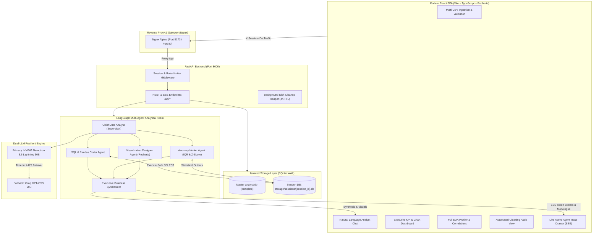

# AI-Powered Data Analyst Engine

[](https://github.com/12ATHARAV/AI-powered-Data-Analyst/actions/workflows/ci.yml)
[](docker-compose.yml)
[](https://fastapi.tiangolo.com)
[](https://langchain-ai.github.io/langgraph/)
[](https://react.dev)
[](https://www.python.org)

An enterprise-grade, multi-agent AI Data Analyst that allows users to upload single or multiple CSV files and interact with their data using natural language. The system answers analytical queries, generates SQL and Pandas code, visualizes data through interactive charts, flags statistical anomalies with plain-English causal reasoning, performs automated data cleaning with full audit trails, and provides real-time streaming observability.

Built for the **Digital Back Office Ltd. AI Engineer Assignment** to demonstrate production-ready AI software engineering, robust concurrency, multi-tenancy isolation, and resilient dual-LLM orchestration.

---

## Architecture Diagram



---

## Assignment Requirements & Capabilities Matrix

| Requirement | Implementation Status | Technical Details |
| :--- | :---: | :--- |
| **Upload & validate multiple CSVs** | ✅ Complete | Multi-file concurrent upload; schema inference, date parsing, duplicate header fixing. |
| **Natural language queries** | ✅ Complete | Multi-turn contextual chat powered by LangGraph Supervisor agent. |
| **Business insights & summaries** | ✅ Complete | Executive Synthesizer produces structured key takeaways, evidence, and next steps. |
| **Interactive charts** | ✅ Complete | Auto-selects Bar, Line, Pie, or Scatter charts dynamically based on data cardinality. |
| **Generate SQL & Pandas code** | ✅ Complete | Outputs verified SQL queries and equivalent Pandas code with 1-click clipboard copy. |
| **Detect anomalies & explain why** | ✅ Complete | Combines Tukey’s IQR ($1.5 \times \text{IQR}$) and Z-Scores ($|Z| > 3$) with explicit plain-English causal reasoning. |
| **Explain reasoning behind answers** | ✅ Complete | Real-time agent monologue streamed live via Server-Sent Events (SSE). |
| **Multi-turn conversation context** | ✅ Complete | Preserves session state and previous query context across questions. |
| **Multi-file analysis (Bonus)** | ✅ Complete | Automatic primary/foreign key discovery and cross-table `JOIN` SQL generation. |
| **Dashboard generation (Bonus)** | ✅ Complete | 1-click executive dashboard featuring 4 KPI cards, 4 analytical charts, and top anomalies. |
| **Data quality & cleaning (Bonus)**| ✅ Complete | Automated remediation of ragged rows, mojibake, missing values, and casing variants. |
| **Streaming responses (Bonus)** | ✅ Complete | Server-Sent Events (SSE) streaming with active terminal drawer in frontend. |
| **Observability & Logging (Bonus)**| ✅ Complete | Full agent execution telemetry: step durations, SQL statements, and LLM model badges. |
| **Docker containerization** | ✅ Complete | Multi-stage frontend Dockerfile + Python 3.12 backend Dockerfile + `docker-compose.yml`. |

---

## Key Features & User Interface

### 1. Natural Language Analyst Chat
* Chat with your data using plain English (e.g., *"Which region generated the highest revenue?"*).
* Returns executive takeaways, structured bullet points, and dynamic charts.
* View and copy the exact generated SQL and Pandas code used to compute the result.

### 2. Multi-Tenant Session Database Isolation (Public Demo Ready)
* Each visitor is automatically assigned an isolated session database: `storage/sessions/{session_id}.db`.
* **Zero Cross-Contamination**: User A uploading sensitive files will never collide with or overwrite User B’s data.
* **Instant Exploration**: New sessions are pre-seeded with sample datasets (`customers`, `products`, `sales`) so visitors can immediately query without uploading files first.
* **Automatic TTL Cleanup**: Stale session databases and temporary uploads older than 4 hours are automatically reaped by a background task.

### 3. High-Concurrency SQLite WAL Mode
* SQLite is configured with **Write-Ahead Logging (WAL)**: `PRAGMA journal_mode=WAL;`.
* Readers never block writers, and writers never block readers.
* Equipped with a 15-second busy timeout (`PRAGMA busy_timeout=15000;`) to prevent `database is locked` errors during concurrent access.

### 4. Automated Data Cleaning & Remediation Audit
* Automatically detects and fixes real-world dirty data issues upon upload:
  * **Mojibake & Corrupted Encoding**: Strips replacement characters (`\ufffd`) and trailing corrupt byte pairs.
  * **Inconsistent Casing**: Harmonizes variants like `"east"`, `"EAST"`, and `"East"` to canonical representations.
  * **Ragged Rows & Format Fixes**: Drops truncated lines and strips currency symbols (`$1,200` $\rightarrow$ `1200.0`).
  * **Contextual Imputation**: Fills missing values using historical customer profiles and statistical modes.
* Dedicated **Cleaning Audit** tab displays every automated fix with original vs. remediated values and rationale.

### 5. Dual-LLM Resilience & API Quota Protection
* Primary inference uses **NVIDIA Nemotron 3.5 Lightning 30B** (`nvidia/nemotron-3.5-lightning-30b-a3b`).
* Seamless fallback to **Groq GPT-OSS 20B** (`openai/gpt-oss-20b`) if timeouts, rate limits, or service interruptions occur.
* In-memory sliding-window rate limiter prevents abuse by capping queries at 15 requests/minute per client.

---

## Example Assignment Queries & Expected Outputs

| # | Question from Assignment Brief | Agent Capability Demonstrated | Expected Visual / Output |
| :-: | :--- | :--- | :--- |
| **1** | *"Which region generated the highest revenue?"* | Aggregation, grouping, ordering | Bar chart of regional revenue + SQL breakdown. |
| **2** | *"Show monthly sales trends."* | Time-series parsing, sequential grouping | Smooth Line chart of monthly revenue progression. |
| **3** | *"Which products are underperforming?"* | Multi-table relational join (`sales` + `products`) | Low-margin / low-revenue ranking + anomaly scan. |
| **4** | *"What are the top five customers?"* | Cross-table join (`sales` + `customers`) | Ranked Bar chart of top 5 customers by spend. |
| **5** | *"Generate SQL for this analysis."* | Relational SQL generation & self-healing | Syntax-highlighted SQL with 1-click copy button. |
| **6** | *"Detect anomalies in the dataset."* | Statistical IQR & Z-score diagnostics | Table of outlier rows with plain-English reasons. |

---

## Quickstart Guide

### Option A: Running with Docker (Recommended)

Make sure you have [Docker Desktop](https://www.docker.com/products/docker-desktop/) installed and running.

1. **Clone the repository:**
   ```bash
   git clone https://github.com/12ATHARAV/AI-powered-Data-Analyst.git
   cd AI-powered-Data-Analyst
   ```

2. **Configure Environment Variables:**
   Copy `.env.example` to `.env` and fill in your API keys (optional; the app operates with offline fallback if no keys are provided):
   ```bash
   cp .env.example .env
   ```

3. **Start the Stack:**
   ```bash
   docker compose up -d --build
   ```

4. **Access the Application:**
   * **Web Application UI**: [http://localhost:5173](http://localhost:5173)
   * **Backend REST API Docs (Swagger)**: [http://localhost:8000/docs](http://localhost:8000/docs)
   * **API Health Check**: [http://localhost:8000/api/health](http://localhost:8000/api/health)

To view real-time container logs:
```bash
docker compose logs -f
```

To stop containers:
```bash
docker compose down
```

---

### Option B: Local Development Setup

#### Prerequisites
* Python 3.12+
* Node.js 20+ and npm

#### 1. Backend Setup
```bash
# Create and activate virtual environment
python -m venv .venv
# Windows:
.venv\Scripts\activate
# Linux/macOS:
source .venv/bin/activate

# Install dependencies
pip install -r backend/requirements.txt pytest pytest-asyncio

# Launch FastAPI development server
python -m uvicorn backend.app.main:app --host 127.0.0.1 --port 8000 --reload
```

#### 2. Frontend Setup
In a separate terminal window:
```bash
cd frontend
npm install
npm run dev
```
Open [http://localhost:5173](http://localhost:5173) in your browser.

---

## Automated Testing & CI/CD

### Running Tests Locally
Run the 14 automated tests covering ingestion, SQL safety, anomaly detection, cleaning audits, and session isolation:
```bash
python -m pytest backend/tests -v
```

Run frontend linter and production build verification:
```bash
cd frontend
npm run lint
npm run build
```

### GitHub Actions CI/CD Pipeline
Every push and pull request triggers [`.github/workflows/ci.yml`](.github/workflows/ci.yml) with 3 parallel jobs:
1. **`backend-checks`**: Sets up Python 3.12, installs dependencies, and runs `pytest backend/tests`.
2. **`frontend-checks`**: Sets up Node.js 20, runs `oxlint`, and verifies TypeScript production build (`tsc -b && vite build`).
3. **`docker-verification`**: Validates `docker compose config`, builds both Docker images, launches the stack, and verifies `GET /api/health` returns `200 OK`.

---

## Technical Assumptions & Implementation Notes

1. **Embedded SQLite with WAL Mode vs. External SQL Server**:
   * *Rationale*: SQLite was chosen to allow 100% self-contained, zero-infrastructure deployment. By enabling `PRAGMA journal_mode=WAL` and a 15-second busy timeout, SQLite achieves high concurrent read throughput without database lock errors.
2. **Data Privacy & Zero Full-Dataset LLM Leakage**:
   * *Design*: Raw dataset rows are **never** transmitted to external LLM providers. The LLM only receives schema definitions and column types to generate queries. The SQL executes locally against SQLite, and only an aggregated summary (maximum 10 rows) is supplied to the synthesizer agent.
3. **Strict SQL Execution Guardrails**:
   * *Security*: The query engine restricts execution to `SELECT`, `WITH`, and `EXPLAIN` statements. Mutation keywords (`DROP`, `DELETE`, `UPDATE`, `INSERT`, `ALTER`, `TRUNCATE`, `ATTACH`, `PRAGMA`) are blocked via regex and AST validation. Connections open in SQLite read-only mode (`?mode=ro`).
4. **Session Database Isolation**:
   * *Multi-Tenancy*: Rather than forcing all visitors into a single shared database file, visitor traffic is partitioned into `storage/sessions/{session_id}.db`. Each new session is initialized with a copy of sample data, ensuring visitors never see or overwrite each other's work.
5. **Dual-Model Resilient Architecture**:
   * *Reliability*: To prevent single-point-of-failure issues with LLM APIs, the system automatically falls back to Groq if the primary NVIDIA API encounters rate limits, timeouts, or downtime.

---

## Project Structure

```text
AI-powered-Data-Analyst/
├── .github/
│   └── workflows/
│       └── ci.yml                 # Automated CI/CD pipeline
├── backend/
│   ├── app/
│   │   ├── agents/                # LangGraph supervisor, SQL coder, chart designer, synthesizer
│   │   │   ├── graph.py
│   │   │   ├── prompts.py
│   │   │   └── state.py
│   │   ├── api/                   # FastAPI route controllers & middleware
│   │   │   ├── middleware_session.py
│   │   │   ├── routes_chat.py
│   │   │   ├── routes_cleaning.py
│   │   │   ├── routes_dashboard.py
│   │   │   ├── routes_eda.py
│   │   │   ├── routes_health.py
│   │   │   └── routes_upload.py
│   │   ├── db/                    # SQLite WAL engine & schema inspection
│   │   │   └── engine.py
│   │   ├── eda/                   # Univariate profiling & anomaly detection (IQR/Z-score)
│   │   │   ├── anomaly.py
│   │   │   └── profiler.py
│   │   ├── ingest/                # CSV parser, validation & data cleaning
│   │   │   ├── cleaner.py
│   │   │   ├── csv_parser.py
│   │   │   └── validator.py
│   │   ├── llm/                   # Dual-LLM client (NVIDIA Nemotron + Groq fallback)
│   │   │   └── client.py
│   │   ├── config.py              # Pydantic BaseSettings environment manager
│   │   └── main.py                # FastAPI entrypoint & background tasks
│   ├── tests/                     # 14 automated unit and integration tests
│   │   ├── conftest.py
│   │   └── test_backend.py
│   ├── Dockerfile                 # Backend container definition (Python 3.12-slim)
│   └── requirements.txt
├── data/
│   └── samples/                   # Pre-packaged sample datasets
│       ├── customers.csv
│       ├── products.csv
│       └── sales.csv
├── frontend/
│   ├── src/
│   │   ├── components/            # ChatArea, DashboardView, EDAReportView, CleaningAuditView, etc.
│   │   ├── App.tsx                # Main SPA layout & navigation
│   │   ├── index.css              # Custom styling & dark-mode aesthetics
│   │   └── main.tsx               # Global fetch multi-tenant session interceptor
│   ├── Dockerfile                 # Multi-stage frontend container (Node 20 build -> Nginx Alpine)
│   ├── nginx.conf                 # Nginx reverse proxy with SSE streaming configuration
│   └── package.json
├── storage/                       # Persistent database and session storage (mounted via Docker volume)
├── .dockerignore                  # Docker build context exclusions
├── .gitignore                     # Git secret & build artifact exclusions
├── docker-compose.yml             # Full-stack Docker orchestration
└── README.md                      # Comprehensive project documentation
```

---

## Submission Notes

* **Repository**: [https://github.com/12ATHARAV/AI-powered-Data-Analyst](https://github.com/12ATHARAV/AI-powered-Data-Analyst)
* **Candidate**: Atharav Dhumone (`atharavdhumone101@gmail.com`)
* **Company**: Digital Back Office Ltd.
* **Role**: Software Engineer Intern / AI Engineer
