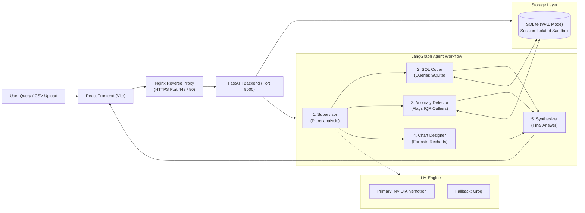

# AI-Powered Data Analyst

[](https://ai-analyst.duckdns.org)
[](https://ai-analyst.duckdns.org)
[](https://ai-analyst.duckdns.org)
[](https://github.com/12ATHARAV/AI-powered-Data-Analyst/actions/workflows/ci.yml)
[](docker-compose.yml)
[](https://fastapi.tiangolo.com)
[](https://langchain-ai.github.io/langgraph/)
[](https://react.dev)

> 🚀 **Live Demo:** [https://ai-analyst.duckdns.org](https://ai-analyst.duckdns.org)  
> 📖 **API Documentation (Swagger):** [https://ai-analyst.duckdns.org/docs](https://ai-analyst.duckdns.org/docs)  
> 🩺 **System Health Endpoint:** [https://ai-analyst.duckdns.org/api/health](https://ai-analyst.duckdns.org/api/health)

An AI-powered data analysis platform that lets users upload CSV files and interact with their data using plain English. It automatically cleans messy data, generates SQL queries, creates interactive charts, detects statistical outliers, and explains its findings in a modern web dashboard.

Deployed on **AWS EC2** with automated **Let's Encrypt SSL (HTTPS)**, **DuckDNS**, **Docker Compose**, and **Nginx reverse proxying**.

---

## How It Works



### The 5-Step Agent Workflow
1. **Supervisor**: Analyzes the user's question, reviews the table schemas, and plans which agents are needed.
2. **SQL Agent**: Formulates safe `SELECT` queries, joins related tables, and runs them against the SQLite database.
3. **Anomaly Hunter**: Runs interquartile range (IQR) and Z-score checks on numerical columns to identify and explain statistical outliers.
4. **Visualization Designer**: Translates the query result into the best chart format (Bar, Line, Pie, or Scatter).
5. **Executive Synthesizer**: Reviews the data and writes a clear, structured summary answering the user's question.

---

## Key Features

* **Natural Language Chat**: Ask everyday business questions and get clear answers with supporting numbers and charts.
* **Automated Data Cleaning**: Automatically handles corrupted characters (mojibake), inconsistent casing (`east` vs `East`), currency symbols (`$1,200` $\rightarrow$ `1200`), and missing values with a full audit log.
* **Multi-Table Analysis**: Detects common columns between multiple CSVs (e.g., `customer_id` across `sales` and `customers`) and performs automatic SQL `JOIN`s.
* **Executive Dashboard**: Pre-built dashboard showing key metrics, revenue trends, product performance, and anomalies.
* **Multi-Tenant Session Isolation**: Each visitor gets their own isolated SQLite session database (`storage/sessions/{session_id}.db`). Multiple people can test the app simultaneously without seeing or overwriting each other's data.
* **Real-time Streaming & Live Logs**: Uses Server-Sent Events (SSE) so users can watch the agent's step-by-step thinking and SQL execution live.
* **Resilient Dual-LLM Support**: Built with NVIDIA Nemotron as the primary model and automatic fallback to Groq if rate limits or network issues occur.

---

## Example Questions to Try

| Question | What It Shows | Output |
| :--- | :--- | :--- |
| **"Which region generated the highest revenue?"** | Grouping & aggregation | Bar chart of regional revenue + SQL breakdown |
| **"Show monthly sales trends."** | Date parsing & time series | Line chart of revenue over time |
| **"Which products are underperforming?"** | Multi-table join (`sales` + `products`) | Low-performing product table + revenue ranking |
| **"What are the top five customers?"** | Multi-table join (`sales` + `customers`) | Ranked bar chart of top spenders |
| **"Generate SQL for this analysis."** | SQL query generation | Formatted SQL query with 1-click copy |
| **"Detect anomalies in the dataset."** | Statistical outlier detection | Table of outlier rows with plain-English reasons |

---

## Deployment & Setup

### Production (AWS EC2 + DuckDNS + SSL)

The live application runs on an AWS EC2 Ubuntu instance with:
1. **DuckDNS**: Maps `ai-analyst.duckdns.org` to the EC2 Elastic/Public IPv4.
2. **Certbot (Let's Encrypt)**: Provides free, auto-renewing SSL certificates.
3. **Nginx Reverse Proxy**: Listens on Port 80 (auto-redirecting to HTTPS) and Port 443 (serving SSL and proxying `/api` to FastAPI).
4. **Docker Compose Production Override**:
   ```bash
   docker compose -f docker-compose.yml -f docker-compose.prod.yml up -d --build
   ```

---

### Local Development

#### Option 1: Running with Docker Locally
```bash
# 1. Clone repository
git clone https://github.com/12ATHARAV/AI-powered-Data-Analyst.git
cd AI-powered-Data-Analyst

# 2. Configure environment variables
cp .env.example .env

# 3. Start containers
docker compose up -d --build
```
Access at [http://localhost:5173](http://localhost:5173).

#### Option 2: Running Without Docker

**Backend:**
```bash
python -m venv .venv
source .venv/bin/activate  # Or on Windows: .venv\Scripts\activate
pip install -r backend/requirements.txt pytest pytest-asyncio
python -m uvicorn backend.app.main:app --host 127.0.0.1 --port 8000 --reload
```

**Frontend:**
```bash
cd frontend
npm install
npm run dev
```
Access at [http://localhost:5173](http://localhost:5173).

---

## Testing & Quality Assurance

Run the automated test suite covering CSV ingestion, SQL safety guardrails, anomaly detection, data cleaning, and session isolation:
```bash
python -m pytest backend/tests -v
```

Run frontend linter and production build check:
```bash
cd frontend
npm run lint
npm run build
```

---

## Project Structure

```text
AI-powered-Data-Analyst/
├── .github/workflows/ci.yml       # Automated CI/CD test and build pipeline
├── backend/
│   ├── app/
│   │   ├── agents/                # LangGraph multi-agent team (supervisor, sql, anomaly, viz, synthesizer)
│   │   ├── api/                   # FastAPI route handlers and session middleware
│   │   ├── db/                    # SQLite engine with WAL mode and session routing
│   │   ├── eda/                   # Statistical profiling and anomaly detection
│   │   ├── ingest/                # CSV parsing, validation, and auto-cleaning
│   │   ├── llm/                   # Dual-LLM client (NVIDIA + Groq fallback)
│   │   ├── config.py              # Application settings
│   │   └── main.py                # App entrypoint
│   ├── tests/                     # Automated pytest suite (14 tests)
│   ├── Dockerfile                 # Backend Docker configuration
│   └── requirements.txt           # Python dependencies
├── data/samples/                  # Sample CSVs (customers.csv, products.csv, sales.csv)
├── frontend/
│   ├── src/                       # React components, dashboard, chat, and chart renderers
│   ├── Dockerfile                 # Frontend multi-stage Docker configuration
│   ├── nginx.conf                 # Local Nginx configuration (Port 80)
│   ├── nginx.prod.conf            # Production Nginx SSL configuration (Port 443 + 80 redirect)
│   └── package.json
├── storage/                       # Local SQLite database and uploads
├── docker-compose.yml             # Local Docker orchestration
├── docker-compose.prod.yml        # Production Docker override (Ports 80/443 + SSL mounts)
└── README.md
```

---

## Key Technical Decisions

* **SQLite with WAL Mode**: Kept local and lightweight with zero external database dependencies. Enabled Write-Ahead Logging (WAL) and a 15-second busy timeout so multiple read/write queries can run concurrently without locking.
* **Session Database Isolation**: Each user gets their own session-scoped SQLite database. When a visitor lands on the site, their session is pre-loaded with sample tables so they can immediately test the app without manual setup.
* **Query Safety**: All SQL generation is restricted to read-only `SELECT` statements. Data modification commands (`DROP`, `DELETE`, `UPDATE`, `INSERT`, `ALTER`) are blocked by code guardrails.
* **Data Privacy**: Raw dataset rows are never sent in bulk to the LLM. Only table schemas and column summaries are passed to generate queries; query execution happens locally, and only the top preview rows are sent to summarize the findings.
