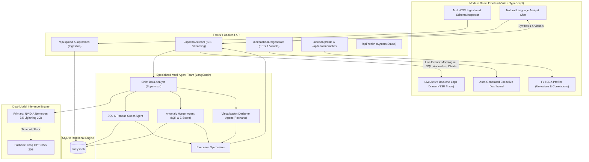

# AI-Powered Data Analyst

A production-ready, multi-agent AI Data Analyst built with **FastAPI**, **SQLite**, **LangGraph**, and **React**. Designed to enable users to upload one or more CSV files and perform full-lifecycle **Exploratory Data Analysis (EDA)**, multi-table SQL queries, anomaly detection, dynamic data visualizations, and automated executive dashboards.

Powered by a resilient Dual-LLM architecture featuring **NVIDIA Nemotron 3.5 Lightning 30B** (`nvidia/nemotron-3.5-lightning-30b-a3b`) as the primary inference engine with seamless failover to **Groq GPT-OSS 20B** (`openai/gpt-oss-20b`).

---

## Architecture Overview



---

## Features

### 1. Data Ingestion & Multi-File Validation
- Upload single or multiple CSV files concurrently (`customers.csv`, `products.csv`, `sales.csv`, etc.).
- Schema detection, date pattern inference, and automatic SQLite table creation with indexed foreign keys.
- Data health audit: missingness percentage, duplicate row counts, zero-variance columns, and Data Health Scores (0-100%).
- Automated cross-table relationship discovery for multi-table JOIN queries.

### 2. Specialized Multi-Agent Team (LangGraph)
- **Chief Data Analyst (Supervisor)**: Decomposes queries, creates analytical plans, and routes tasks to domain specialists.
- **SQL & Pandas Coder Agent**: Writes read-only SQLite queries, joins multiple tables, and handles syntax self-healing.
- **Anomaly Hunter Agent**: Detects statistical outliers using Tukey's IQR boundaries ($1.5 \times \text{IQR}$) and Z-Scores ($|Z| > 3$), providing plain-English causal explanations of *why* each row was flagged.
- **Visualization Designer Agent**: Formats responsive Recharts specifications (Bar, Line, Pie, Scatter) tailored to the analytical data.
- **Executive Synthesizer**: Produces executive-grade answers with key findings, data evidence, reasoning breakdown, and strategic recommendations.

### 3. Active Backend Logs Terminal
- Real-time Server-Sent Events (SSE) stream directly into the modern developer drawer in the UI.
- Displays agent transitions, internal thoughts, executed SQL queries, duration, and model failover alerts.

### 4. Executive Dashboard & Full EDA Profiler
- **Executive Dashboard**: KPI summary cards (Total Revenue, Orders, Active Customers, Catalog, Anomalies) and a 4-chart analytical grid.
- **Full EDA Profiler**: Univariate numeric summary statistics (mean, median, std, min, max, IQR, skewness, shape), categorical distribution frequencies, and Pearson correlation matrices.

---

## Quickstart

### Prerequisites
- Python 3.12+
- Node.js 18+ and npm

### 1. Environment Configuration
Create a `.env` file in the root directory (or use the provided `.env.example`):
```env
# Primary LLM: NVIDIA Nemotron 3.5 Lightning 30B
NVIDIA_API_KEY=your_nvidia_api_key_here
NVIDIA_BASE_URL=https://integrate.api.nvidia.com/v1
NVIDIA_MODEL=nvidia/nemotron-3.5-lightning-30b-a3b

# Fallback LLM: Groq GPT-OSS 20B
GROQ_API_KEY=your_groq_api_key_here
GROQ_BASE_URL=https://api.groq.com/openai/v1
GROQ_MODEL=openai/gpt-oss-20b

# Server & Storage
BACKEND_PORT=8000
FRONTEND_PORT=5173
DATABASE_PATH=storage/analyst.db
UPLOAD_DIR=storage/uploads
SAMPLE_DIR=data/samples
```

### 2. Start the Backend
```bash
# From the repository root
python -m uvicorn backend.app.main:app --host 127.0.0.1 --port 8000 --reload

# Or from inside the backend/ directory
python -m uvicorn app.main:app --host 127.0.0.1 --port 8000 --reload
```
Both work: app imports are package-relative and data paths are anchored to the project root. The FastAPI backend will be available at `http://127.0.0.1:8000`. Swagger API docs at `http://127.0.0.1:8000/docs`.

### 3. Start the Frontend
```bash
cd frontend
npm install
npm run dev
```
Open `http://127.0.0.1:5173` in your browser.

---

## Running with Docker

You can run the entire application with Docker Compose:
```bash
docker compose up --build
```
- Frontend: `http://localhost:5173`
- Backend API: `http://localhost:8000`

---

## Running the Automated Test Suite

Run the backend pytest test suite covering CSV ingestion, SQL safety guardrails, EDA profiling, and anomaly diagnostics:
```bash
pytest backend/tests/test_backend.py -v
```

---

## Example Assignment Queries & Verification

| Query | What It Demonstrates |
| :--- | :--- |
| **"Which region generated the highest revenue?"** | Multi-row comparative aggregation, grouping by region, dynamic Bar chart. |
| **"Show monthly sales trends."** | Date parsing with `strftime`, sequential time-series grouping, smooth Line chart. |
| **"Which products are underperforming?"** | Multi-table join (`sales` + `products`), revenue & margin ranking, anomaly scanning. |
| **"What are the top five customers?"** | Multi-table join (`sales` + `customers`), top N aggregation by spend, Bar chart. |
| **"Generate SQL for this analysis."** | Clear SQL query display with syntax formatting and 1-click copy button. |
| **"Detect anomalies in the dataset."** | Statistical IQR & Z-score analysis with explicit causal reasoning for flagged rows. |
